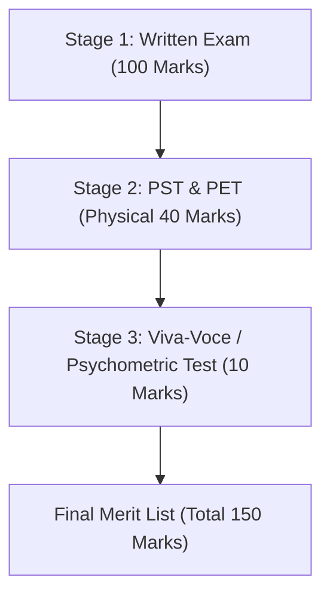

# Assam Police Sub-Inspector (SI) - Selection Scheme

## Physical Efficiency Test (PET) Details:
* **Male Candidates:**
  * 1600 Meters Race (Max time: 450 seconds / 7.5 mins; points awarded based on time).
  * Long Jump (Minimum 335 cm in 3 attempts; higher distance gives higher marks).
* **Female Candidates:**
  * 800 Meters Race (Max time: 240 seconds / 4 mins).
  * Long Jump (Minimum 244 cm in 3 attempts).
