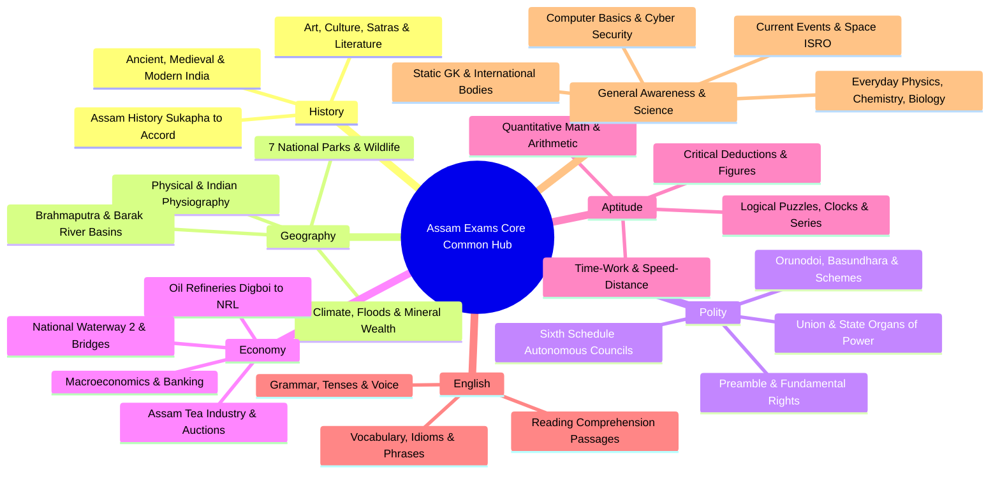

# Circular Radiating Syllabus Architecture: Assam Government Examinations

This document explains the concentric radial model of the Assam state competitive examinations.

---

## 🌀 Circular Radiating Visualization Architecture

The circular architecture consists of 4 concentric orbits radiating outward from a unified foundational core:

```
[ Outer Orbit: 14+ Assam Recruitment Cadres (APSC, ADRE, Police, TET, APDCL, Health, etc.) ]
               ▲
               │
    [ Orbit 2: Granular Subtopics & Core Concepts ]
               ▲
               │
        [ Orbit 1: 7 Mentally-Clear Disciplines ]
          • History (Indian, Assam, Culture)
          • Geography (Physical, Rivers, Parks)
          • Polity (Constitution, Schemes)
          • Economy (Tea, Oil, Waterways)
          • Aptitude (Math, Logic, Critical)
          • English (Grammar, Vocab, RC)
          • General Awareness & Science
               ▲
               │
      [ Orbit 0 (Center Hub): Universal Core Syllabus ]
```

---

## 🎨 Interactive Visualizations

1. 🌐 **[Interactive Circular Radiating HTML Viewer](../Diagrams/circular_radiating_diagram.html)**:
   * Dynamic SVG-based canvas with animated radiating light rays.
   * Concentric orbital rings with glowing hover states.
   * Click-to-inspect info card providing details on each domain and subtopic.

2. 📐 **[Mermaid Syllabus Architecture Diagram](../Diagrams/SYLLABUS_ARCHITECTURE.md)**:
   * Flowcharts representing the 7 domains and examination mapping.

---

## 📊 Radial Mindmap Structure


