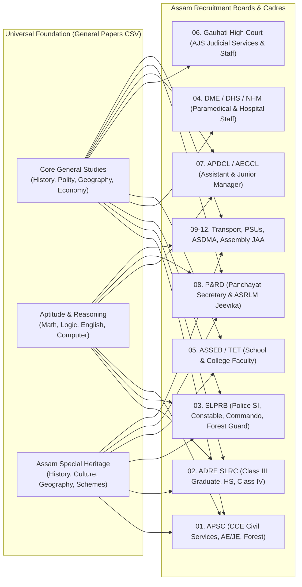

# Assam Government Examinations: Syllabus & Architecture Diagrams

This directory contains visual architecture diagrams representing the complete structure of Assam Government competitive examinations and the unified 7-domain universal syllabus.

---

## 1. Universal General Syllabus Architecture (7 Core Domains)

```mermaid
flowchart TD
    Root["Assam Govt Exams: Universal General Syllabus"]

    Root --> D1["1. History"]
    Root --> D2["2. Geography"]
    Root --> D3["3. Polity"]
    Root --> D4["4. Economy"]
    Root --> D5["5. Aptitude"]
    Root --> D6["6. English"]
    Root --> D7["7. General Awareness & Science"]

    %% History Breakdown
    D1 --> H_Ind["Ancient, Medieval & Modern Indian History"]
    D1 --> H_Asm["Assam History (Ancient, Ahoms, Freedom Struggle, Accord)"]
    D1 --> H_Clt["Art, Culture & Literature (Sankardeva, Satras, Bihus)"]

    %% Geography Breakdown
    D2 --> G_Ind["Physical & Indian Geography (Rivers, Monsoon, Soils)"]
    D2 --> G_Asm["Assam Geography (Brahmaputra & Barak Basins, Floods)"]
    D2 --> G_Env["Environment & Ecology (7 National Parks, Climate Action)"]

    %% Polity Breakdown
    D3 --> P_Ind["Indian Constitution & Governance (FR, DPSPs, Parliament)"]
    D3 --> P_Asm["Assam Governance (State Assembly, Gauhati HC, 6th Schedule)"]
    D3 --> P_Sch["Assam Flagship Schemes (Orunodoi, Basundhara, Nijut Moina)"]

    %% Economy Breakdown
    D4 --> E_Ind["Indian Economy Essentials (GDP, Inflation, RBI, Budget, GST)"]
    D4 --> E_Asm["Assam Economy (Tea Industry, Oil, Waterways, Bridges)"]

    %% Aptitude Breakdown
    D5 --> A_Qnt["Quantitative Aptitude / Math (Arithmetic, Time-Work, Mensuration, DI)"]
    D5 --> A_Log["Logical Reasoning (Series, Puzzles, Coding, Directions, Syllogisms)"]
    D5 --> A_Vrb["Verbal Reasoning & Critical Logic (Assumptions, Arguments)"]

    %% English Breakdown
    D6 --> En_Grm["English Grammar (Parts of Speech, Tenses, Voice, Narration)"]
    D6 --> En_Voc["Vocabulary & Word Power (Synonyms, Idioms, One Word)"]
    D6 --> En_Cmp["Reading Comprehension (Passages, Cloze Test, Para-Jumbles)"]

    %% General Awareness Breakdown
    D7 --> S_Sci["Everyday Science (Physics, Chemistry, Biology)"]
    D7 --> S_GK["Static GK & International Bodies (UN, Awards, Days)"]
    D7 --> S_CA["Current Affairs (National, Assam, Space ISRO, Defense, Sports)"]
    D7 --> S_Cmp["Computer Fundamentals & Digital Literacy (MS Office, Cyber)"]
```

---

## 2. Examination Cadre Mapping Flowchart

---

## 3. The 12 Canonical Categories of Assam Government Recruitment

```mermaid
flowchart TD
    Gov["Government of Assam: Recruitment Ecosystem"]

    Gov --> C01["01. APSC (Public Service Commission)"]
    Gov --> C02["02. ADRE SLRC (Direct Recruitment Commission)"]
    Gov --> C03["03. Assam Police SLPRB (Police & Uniformed)"]
    Gov --> C04["04. Health (DME, DHS, DHS-FW, NHM)"]
    Gov --> C05["05. Education (TET, DSE, DHE, Universities)"]
    Gov --> C06["06. Judiciary (Gauhati High Court & AJS)"]
    Gov --> C07["07. Power Sector (APDCL, AEGCL, APGCL)"]
    Gov --> C08["08. PnRD (Panchayat & Rural Development, ASRLM)"]
    Gov --> C09["09. Transport (Enforcement Branch, ASTC, IWT)"]
    Gov --> C10["10. PSUs & Boards (Apex Bank, AGCL, Sericulture)"]
    Gov --> C11["11. Revenue (Lot Mandal & ASDMA Disaster)"]
    Gov --> C12["12. Assam Legislative Assembly Secretariat"]

    C01 --> CCE["Combined Competitive Exam (CCE Civil Services)"]
    CCE --> CCE_Pre["Stage 1: Prelims (GS-I & CSAT)"]
    CCE --> CCE_Main["Stage 2: Mains (GS I-V, Ethics, Essay)"]
    CCE --> CCE_Gaz["Stage 3: Statutory Rules Gazette"]

    C02 --> ADRE_G3["Class III (Graduate & Higher Secondary)"]
    C02 --> ADRE_G4["Class IV (HSLC & Class VIII Passed)"]
    C02 --> ADRE_DRV["Class III (Driver & Technical)"]

    C03 --> POL_SI["Sub-Inspector (UB, AB, Commando)"]
    C03 --> POL_CONST["Constable & Forest Guard Cadres"]
```

